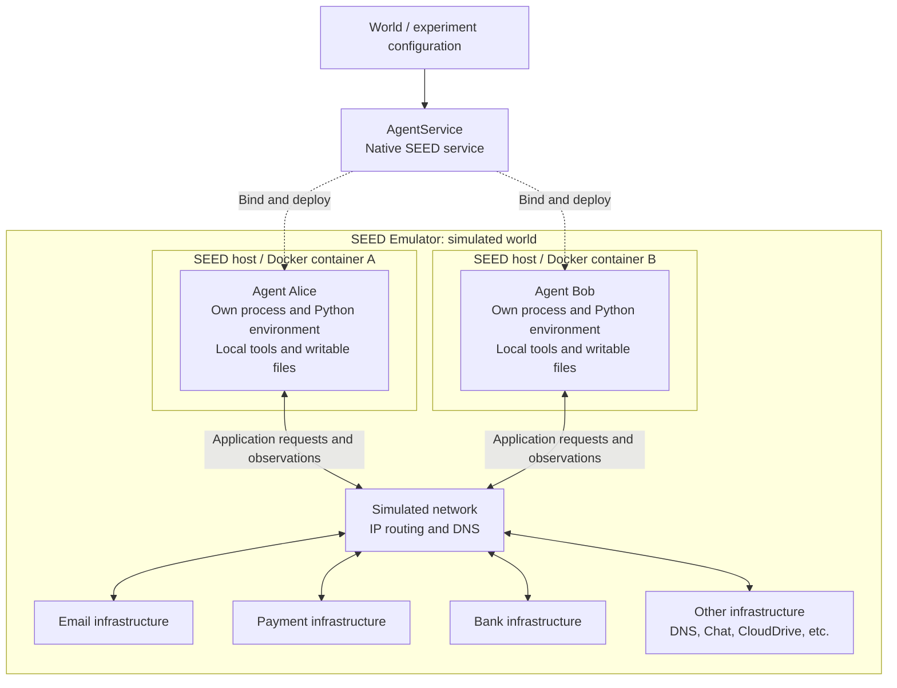
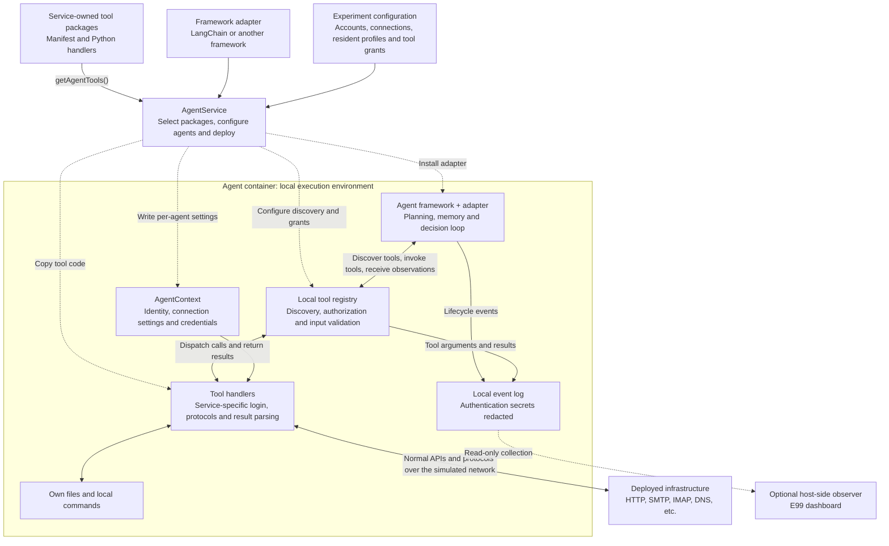
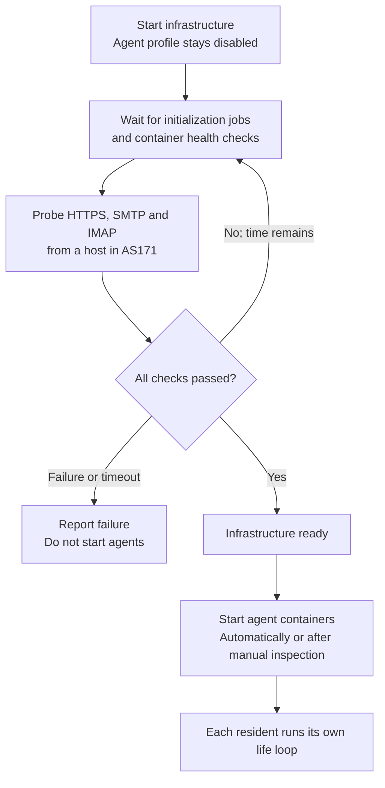
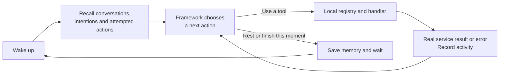
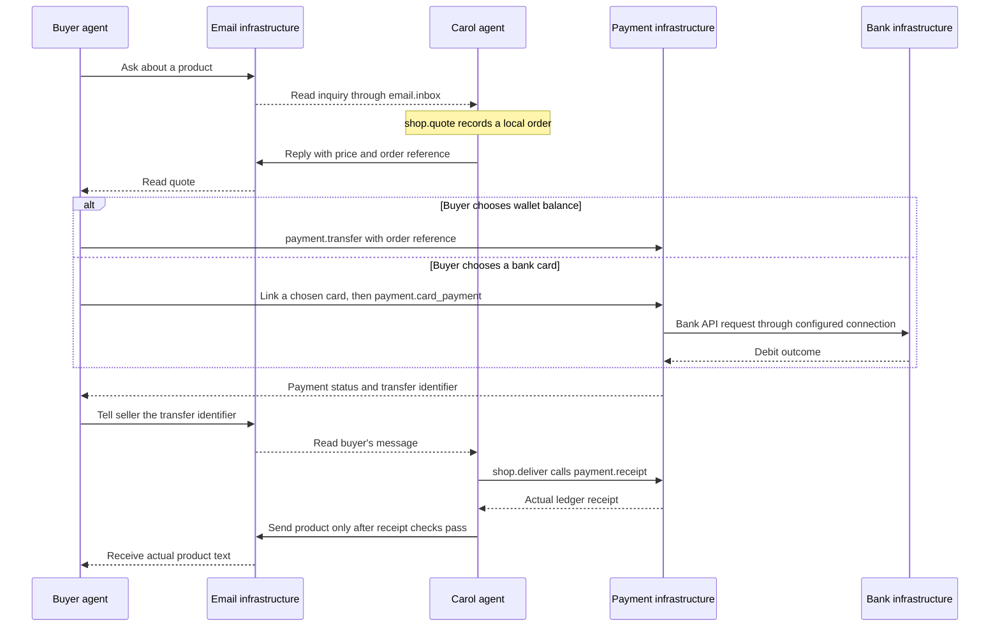

# AgentService design

AgentService puts agents inside the simulated world. Each agent runs on a bound
SEED host, has its own execution environment, and uses the deployed infrastructure
through the simulated network. Applications provide tools; an interchangeable
agent framework decides when to use them.

The examples below are Python-like pseudocode. They show responsibility and data
flow, omitting protocol details and error handling unless these explain the
design. Helper names are explanatory, not additional AgentService APIs.

## The simulated world



The dashed arrows describe deployment: AgentService is a SEED service layer that
configures agents and binds their virtual nodes to hosts. Each agent gets a
separate host/container, Python environment, process user and working files. The
solid arrows describe runtime communication through the simulated network.

An agent can read mail, make a payment or query a bank just as a program on a user
machine would. Its network position, DNS settings and application credentials
influence what it can observe and do. Applications remain independent Services or
Bundles and can run without agents.

The agent's planning loop, tools and protocol clients all run inside its container.
An LLM endpoint may be external, but using that endpoint does not move the agent
outside the simulation. Network access to the model is configured by the experiment.

The experiment assembles these independent parts before agents start:

```python
world = configure_network_and_applications()       # Infrastructure and accounts
agents = AgentService()
for application in selected_applications:
    agents.addToolsFrom(application)               # Select its tool package

for person in residents:
    agent = agents.install(person.name)
    agent.setFramework(adapter_directory)
    agent.setService("email", person.mail_connection)
    agent.setService("payment", person.wallet_connection)
    agent.allowTools(*available_tool_names)
    bind_to_own_host(agent, person.host)           # Normal SEED virtual-node binding

compile_world(world, agents)                      # Render, attach bundles, compile
# Compilation prepares deployment files; it does not run the agents.
```

E99 gives every resident the same tool entrypoints, but separate application
accounts. Installing email infrastructure and selecting its tools are explicit
experiment choices; deployment alone does not automatically register tools.

## Inside AgentService

AgentService separates deployment, framework-specific decision making and
service-specific interaction. It installs the runtime in each agent container;
there is no separate tool server between the agent and the applications.



### Tools connect agents to the world

Each application maintains its own tool package. A package describes the available
operations and implements how to perform them: for example, reading a mailbox,
sending a chat message or making a payment. The service exports this package with
`getAgentTools()`. The experiment selects it through `addToolsFrom(...)`, and
AgentService copies the selected packages into agent images and installs their
dependencies.

Registration is local to the agent runtime. The registry loads the package
manifests, associates tool names with their handlers, and exposes only the tools
allowed for that agent. All selected packages are currently copied to each agent
managed by the same AgentService; the per-agent allowlist determines which
entrypoints are available through discovery and invocation.

A tool call follows this path:

1. The framework receives the authorized tools' names, descriptions and input
   schemas, then chooses an operation and its arguments.
2. The local registry checks the agent's tool grant and validates the arguments.
3. The handler obtains that agent's application connection and credentials from
   `AgentContext`, then calls the real application through the simulated network.
   Local diagnostic tools can instead inspect files or run commands in that
   agent's own container.
4. The handler converts the response into an observation. The framework uses it
   to update its understanding and choose its next action.

For example, `email.inbox` logs into the agent's mailbox over IMAP and returns
messages. The agent may then choose `payment.transfer`; that handler authenticates
as the agent's payment user and submits a transfer to the payment API. Balances and
messages come from the running applications, rather than a separate model of the
world maintained by AgentService.

The registry controls tool entrypoints; applications enforce their own account
permissions and business rules. Granting a payment tool does not grant access to
another user's funds. The local allowlist is not a sandbox for arbitrary code
running in the agent process. Likewise, a local PKI tool does not acquire command
access or administrator privileges in another container.

Registration and invocation are two different moments:

```python
# Compilation: collect source code and make it available inside each agent image.
package = application.getAgentTools()              # tools.json + Python handlers
copy_package_into_agent_image(package)

# Agent startup: register definitions locally; defer handler imports until needed.
for package in installed_packages:
    for definition in read_manifest(package):
        registry.register(definition.name, definition, package.directory)

# Runtime: every framework and the local CLI use the same invocation path.
def invoke(name, arguments):
    emit("tool_started", name, arguments)
    try:
        require_allowed(name)                     # Before importing a handler
        validate(arguments, registry[name].input_schema)
        handler = load_handler(registry[name])
        result = handler(arguments, agent_context)
    except Exception as error:
        emit("tool_failed", name, error)
        raise
    emit("tool_finished", name, result)
    return result

def email_inbox(arguments, context):
    connection = context.service("email")         # This resident's account
    return read_mail_over_imap(connection, arguments)
```

The registry knows how to locate and call a tool. The email handler knows IMAP;
the payment handler knows the payment API. Neither needs to know which agent
framework chose the call. Events retain complete business arguments and results;
the event writer redacts authentication secrets before writing logs. E99's
observer reads those records to display tool calls and mail bodies, without
executing the tools itself.

### Framework adapters connect decision engines to the runtime

AgentService does not implement one particular planning algorithm. A framework
adapter supplies `run(context)` and connects its framework to two local operations:
`context.tools.list()` and `context.tools.invoke(name, arguments)`.

The adapter translates tool definitions into the framework's format, routes calls
through the registry, and returns observations to the framework. Prompts, memory,
model settings and the decision loop belong to the adapter and experiment.
Service handlers retain their own protocol and authentication logic.

E99 currently uses a LangChain adapter. Another framework can provide a different
adapter without changing the application tools or business-service images. A
simple script runner uses the same tool entrypoints without an LLM. Runtime events
report agent progress and complete business tool arguments/results to an observer,
with authentication secrets removed. This is independent of the chosen framework.
E99 starts infrastructure first, verifies initialization and reachability, then
starts resident containers; later outages remain observations for residents.

The adapter is the translation layer, rather than a second implementation of
each application's tools:

```python
def run(context):
    framework_tools = []
    for definition in context.tools.list():
        framework_tools.append(framework.wrap_tool(
            name=definition.name,
            description=definition.description,
            schema=definition.input_schema,
            callback=lambda arguments, name=definition.name:
                context.tools.invoke(name, arguments),
        ))
    framework.run(tools=framework_tools, profile=resident_profile)
```

Replacing `framework` changes the decision engine and its loop. The registry,
application handlers and deployed applications keep the same responsibilities.

## E99: starting the world and living in it

The following behavior belongs to the E99 experiment and its LangChain adapter.
AgentService provides deployment and local tool execution; it does not require
every experiment to use this startup policy or resident loop.

### Infrastructure readiness precedes resident life



```python
def start_world(infrastructure_only=False, agents_only=False):
    if not agents_only:
        compose.start_infrastructure()            # Agents use an opt-in profile

    wait_until_ready(
        initialization_jobs_exit_successfully,
        infrastructure_containers_healthy,
        https_smtp_imap_reachable_from_as171,
    )                                            # Abort on failure or timeout

    if not infrastructure_only:
        compose.start_agents()
```

`start.py --infrastructure-only` stops at the ready state, leaving the world
running for manual inspection. `--agents-only` checks readiness again before
starting residents. A successful initial check cannot guarantee permanent
availability; later service failures become tool observations that residents can
respond to.

### Residents choose actions from their own observations



```python
while not stopping:
    memory = recall_personal_memory()
    emit("waking", intention=memory.intention)
    observation = {"time": now(), "memory": memory, "recent_activity": recent_calls()}
    try:
        # Several calls can occur; reserve steps for a normal pause at the budget.
        result = framework.resume(conversation_history, observation, step_limit)
        save_conversation(result)
        rest = chosen_wake_time_or_default()
    except ModelOrLoopError:
        keep_attempted_tool_calls()               # A payment may already be accepted
        rest = recovery_backoff()
    wait_until_next_moment(rest)
```

The wake-up observation is generated locally; it contains no externally assigned
purchase or message task. The resident's background, memory and service results
inform its choices. Carol's background describes a shop owner, but does not force
other residents to buy. `life.remember`, `life.recall` and `life.rest` give the
resident explicit ways to retain intentions and choose pauses. The adapter bounds
model context and steps per moment; complete tool results remain in event logs.

Before another model decision would consume the reserved graph steps, the adapter
returns a local pause message with no tool requests. The graph ends normally, its
complete conversation is saved, and the resident rests. This is an activity
boundary rather than a failed moment; it makes no extra LLM request. The next
moment receives that history and recent tool observations.

Attempt records matter when a request times out: the service might already have
accepted it. Residents are instructed to inspect receipts or ask the other person
before repeating payments. Memory alone does not guarantee exactly-once actions.

### Example: a voluntary purchase

This is one possible interaction, not a scheduled sequence. Quoting and delivery
are experiment-owned `shop` tools; transfers and mail still use the independent
Payment and Email infrastructure.



Card linking uses `world.link_card` to compose the payment and bank APIs with the
resident's own account. Subsequent payments use the linked source identifier;
the model does not handle authorization codes or bank login credentials.

```python
def deliver_order(order_id, transfer_id):
    order = read_local_order(order_id)
    if order.status == "delivered":
        return order                             # No second delivery
    if order.status in ("delivering", "delivery_uncertain"):
        return require_delivery_review(order)

    receipt = tools.invoke("payment.receipt", {"id": transfer_id})
    # Check committed state, amount, currency, seller, order reference and funding.
    require_receipt_matches(order, receipt)
    require_receipt_not_used_for_another_order(receipt)
    save_order(order, status="delivering")
    try:
        delivery = tools.invoke("email.send", product_message(order))
        require(delivery.sent)
    except Exception:
        save_order(order, status="delivery_uncertain")
        raise                                    # Inspect before retrying
    save_order(order, status="delivered")
```

Order state lives in the seller's files. Mail lives on the mail server, and money
lives in the bank/payment systems. A model's claim that a payment succeeded does
not substitute for a ledger receipt. Delivery here means SMTP acceptance of the
product email, not proof that the buyer has read it. The observer shows completed
orders alongside the underlying tool arguments and results.

The concrete implementation lives in E99's [startup coordinator](../../experiments/E99_virtual_world/start.py),
[framework adapter](../../experiments/E99_virtual_world/adapters/langchain/adapter.py),
[shop tools](../../experiments/E99_virtual_world/tools/shop/handlers.py) and
[observer](../../experiments/E99_virtual_world/monitor.py).

## What infrastructure developers provide

A service integration has two parts: deploy usable infrastructure, and provide the
tools an agent needs to interact with it. Keep them together:

```text
services/<Service>/              bundles/<Bundle>/
|-- ... application deployment  |-- ... application deployment
`-- tools/                      `-- tools/
    |-- tools.json                  |-- tools.json
    |-- handlers.py                 |-- handlers.py
    `-- ... protocol helpers        `-- ... protocol helpers
```

The maintainer provides:

- **Infrastructure:** a working Service or Bundle, normal application endpoints,
  account provisioning and documented network/certificate requirements.
- **Tools:** a manifest containing names, descriptions and input schemas, plus
  handlers with `handler(arguments, context)`. Handlers use the agent's connection
  settings, implement login and protocol operations, and return useful structured
  results. Tool code must work inside the agent container without importing
  repository example code or a particular agent framework.
- **Export and connection settings:** `getAgentTools()` returns the tool package;
  its configuration documentation explains which endpoint, identity, credentials
  and auxiliary connections the handlers require. Dependencies belong to the
  package. For several application instances, the provider must define how its
  tools select among the configured instances.

The experiment author then selects those packages, assigns each agent its accounts
and exact tool grants, chooses a framework adapter, and binds agents to hosts.
Agent settings must be ready before `emu.render()`; bundles attached after render
must use the same planned addresses and certificate paths. This does not require
adding service-specific branches to AgentService.

Payment, Email and Bank currently export packages using this design. Domain/DNS,
Chat and CloudDrive maintainers can add their own packages in the same way; their
existing applications do not yet export AgentService tools. Shared Network and
PKI diagnostics are optional packages under `services/AgentService/tools/`.

See the [AgentService README](../../services/AgentService/README.md) for the small
configuration examples and current runtime details.
