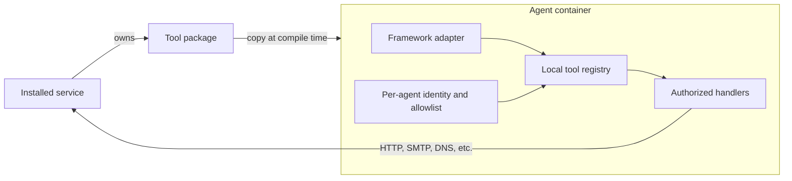

# Agents inside the simulated world

Each agent lives on a bound SEED node. It has local files, a Python environment,
and the same simulated network access as an ordinary user machine.

The application provider chooses which tools describe its public operations.
The example selects packages only for services it installed. AgentService copies
those packages to each agent container and installs a separate immutable policy
for each identity. It does not enumerate running host containers or control the
Docker daemon. Fine-grained tool permissions apply both to discovery and calls.

A framework adapter exposes `run(context)`. It may use any framework installed in
the node's virtual environment. Framework-specific code translates tool schemas
and routes tool calls through `context.tools.invoke`. E99 uses a LangChain adapter configured through a runtime `.env`.
Framework integrations can be added independently.

World services remain responsible for their own authentication and authorization.
Local tool permissions are an application contract, not protection against
arbitrary code running in the same process. Stronger process isolation and
additional framework adapters remain future work.
H99 assembles business-service providers; E99 selects grants separately for five agents.
