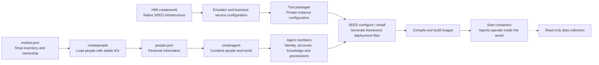
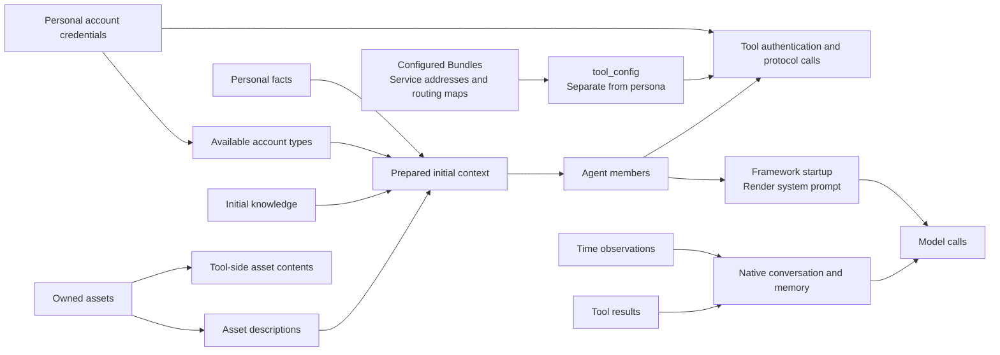
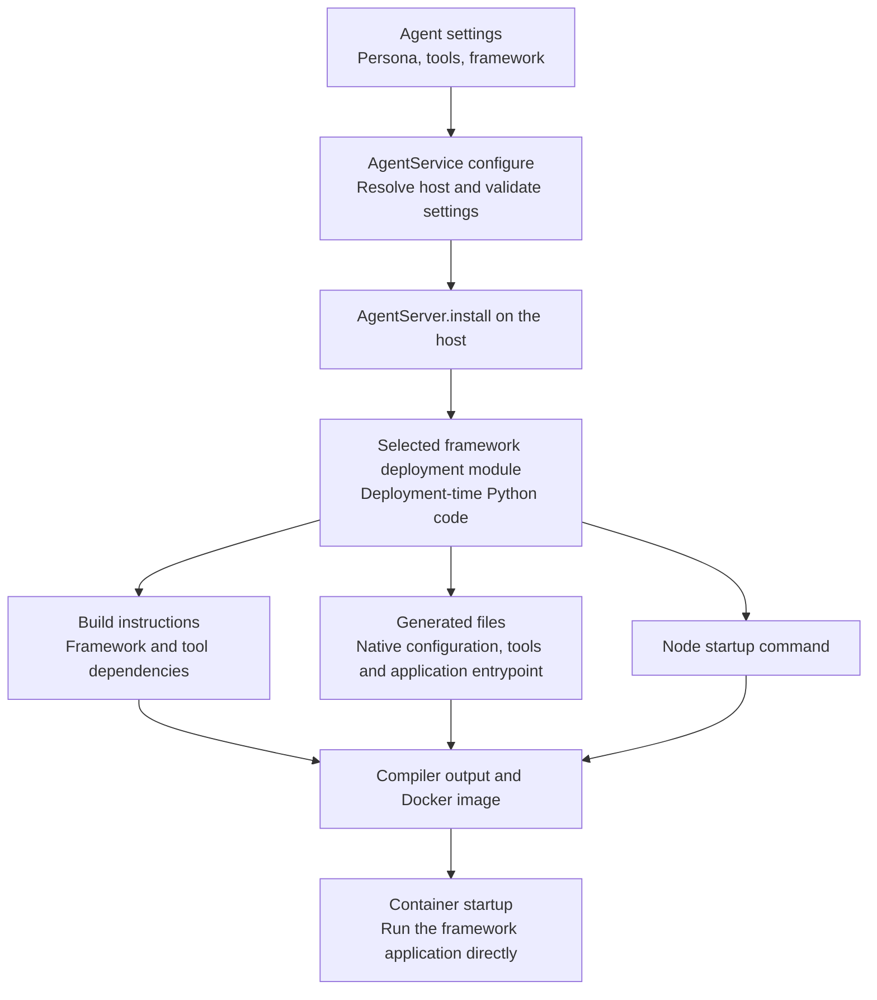
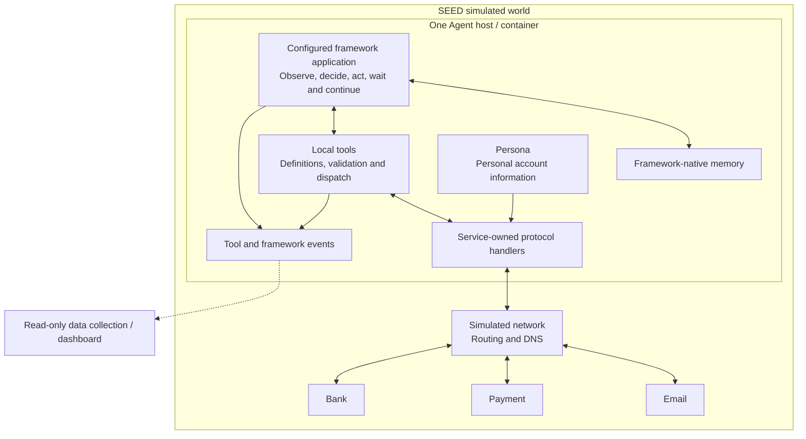

# AgentService design

The world is assembled in three stages: `createpeople`, `createworld` and
`createagent`. A person describes who someone is. The world supplies infrastructure
and its Services/Bundles independently of people. Agent creation combines the two,
resolves personal account access and gives each person an execution environment
and a selected agent framework inside the simulation.

## Status and scope

AgentService and E99 implement single-person creation and deployment-time
framework generation described here. E99 loads people through `createpeople`,
imports H99's `createworld`, and calls
`AgentService.createagent` for each person. The people generator remains a
handwritten JSON input. Examples below illustrate responsibilities and omit some concrete
arguments; they are not separate command-line tools.

The normal entrypoint is `agent = agentservice.createagent(config)`, with one
person's structured configuration. It returns an Agent configuration object,
assigns its virtual node name, and defaults to LangChain and all registered tools.
It does not start a framework or contact a model. Existing optional setters remain:

- `setPersona(persona)`
- `setTools(tools)`
- `setFramework(framework)`

Other settings use defaults within the framework integration or existing experiment
configuration. Additional Agent APIs should be introduced only when a concrete
requirement appears. Normal SEED service installation, node binding, rendering
and compilation remain part of deployment.

Top-level code declares metadata, objects and their relationships. Each object
stores those declarations. Framework- and compiler-specific deployment code reads
the metadata during configure/install to generate actual files and commands.

## Three stages of world creation



### createpeople: describe the people

A future generator will produce personal information. For now, a JSON file is
sufficient. A person is independent of the framework used to run them and of the
container on which they will eventually live.

```json
{
  "people": [
    {
      "id": "4de4ceb9-78be-4d9b-8236-6d080b70d1f9",
      "name": "Alice",
      "background": "Alice enjoys photography and getting to know people.",
      "interests": ["photography", "cooking"],
      "relationships": [{"person": "18d0a020-1e17-4603-bd52-e3fa5e2d3e85", "relationship": "friend"}],
      "accounts": {
        "email": {
          "email": "alice@mail.com",
          "password": "example-password"
        }
      }
    },
    {
      "id": "18d0a020-1e17-4603-bd52-e3fa5e2d3e85",
      "name": "Bob",
      "background": "Bob enjoys music and considers purchases carefully.",
      "interests": ["music", "games"]
    }
  ]
}
```

The stable `id` identifies the person independently of their name, mailbox, bank
account or deployment host. E99 uses canonical UUIDs generated once and saved in
`people.json`; loading a file never generates replacement IDs. Names can change
or repeat. Runtime event identity, framework threads and saved-memory directories
use the person ID. Virtual node and container names describe deployment only.
The fields above are an initial example, not a complete schema for the future
people generator. Personal facts, background, preferences, relationships and
personal account information belong here. A person's mailbox, payment identity,
bank accounts and personal credentials are part of their persona. Service addresses,
protocol settings and wallet routing maps belong to tools, supplied by the configured
Bundle instances. More than one account or
bank instance can be represented in the corresponding account data when needed.

An initial file may include existing accounts as above. E99 passes each person's
configuration directly to `AgentService.createagent`, separately initializes
application accounts, and collects configured tool packages.
`createpeople` does not require a world or create
business accounts. E99's `people.json` owns each person's `accounts.email`,
`accounts.payment` and `accounts.bank` declarations, including initial personal
balances and cards. Mailbox addresses are explicit, never inferred from names or IDs.
Bank registration uses the declared mailbox credentials and the person UUID as
its external customer identifier.
The initial persona is sometimes described as the person's soul; it is distinct
from the memories accumulated while running.

The framework integration uses descriptive fields to build the framework's profile
or prompt. Tools read private account fields to authenticate. The full persona
JSON must not be copied wholesale into the model prompt: account passwords and
other authentication material are excluded from prompt rendering and redacted
from observation logs. No framework-specific Python class or memory database is
required in the people file.

### Preparing the initial context

Preparation separates personal facts, account access, initial knowledge and owned
assets. Account access contains a person's account declarations and credentials. The model
receives only the account information needed for business choices, such as its
email and available account types. Service URLs, protocol ports, authentication
endpoints and wallet routing IDs are private tool configuration. A model calls a
tool with business arguments; the tool resolves the destination, authenticates
and issues the protocol request. Owned assets also have a public description and a tool-side payload; E99
shows the shop's product metadata while retaining delivery contents in inventory.

```python
people = createpeople('people.json')
for person in people:
    agent = agentservice.createagent(person)
```

E99 keeps personal fields and account declarations in `people.json`, and product
definitions in `market.json`. `createpeople` assembles the initial contact directory
and owned inventory before passing each person to AgentService.
The market's `owner` is a stable person UUID. Only the owner's possessions contain
the products and delivery payloads. Other people start without product knowledge.
The JSON inputs do not repeat the product catalog for every person.
E99's `initialize_accounts` function lives in `virtual_world_with_agents.py` and
declares application account metadata;
tool configuration is collected separately from Bundle exports in `prepare_tools(bundles)`.
`createagent(config)` copies one person's configuration into the deployment
object's `_persona` dictionary. Personal fields are stored there once; install
writes that dictionary directly into the runtime configuration. `agent.vnode`
identifies its deployment slot. The runtime context exposes personal members
for framework and tool execution.

E99 runs a small HTTP shop catalog in the owner's Agent container. The experiment
declares its startup and registers its address as private shop tool configuration.
`shop.catalog` makes a real network request; its result introduces product
descriptions and prices into the customer's conversation. It does not read a
preloaded product list from the customer's knowledge. Quotes and verified delivery
remain owner tools. AgentService itself does not know about shops or start them.

When the container starts, the framework's `build_system_prompt` reads these
members to render the personal profile, account types, initial knowledge and
asset descriptions. It adds default instructions for continuous autonomous life.
Account credentials and asset `content` payloads are excluded. Tool descriptions
explain service-specific business workflows; framework code contains no bank or
payment endpoint configuration. Storing a member does not automatically expose
it to the model: only prompt sections and tool observations do so.



Agent decision calls use the framework's assembled system prompt. During the
run, time observations and tool results enter the framework conversation, and its
native checkpointer and summarization retain experience. Starting knowledge does
not assert current balances, service availability or transaction outcomes.

### createworld: supply the environment

This stage configures the shared network and selected Services/Bundles. It reads
world configuration, without receiving people, loading `people.json`, modifying
personas or building personal prompts. Infrastructure can be compiled and used
without creating any Agents. World configuration contains service settings,
financial products and institutional administrator and sender accounts.
Personal accounts and opening balances belong to people, not to `world.json`.
The world builder never derives mailbox users from bank customer lists.
`world.json` maps instance names to service settings. Each entry uses the common
`hostname`, `asn`, `port` and `configuration` fields; Bundle types are defined in code. Application-specific
settings stay with their own entry. There is no separate hostname map or bank list.
Each entry's `connections` lists partner instance names: `email` for a bank's
mail providers and `bank` for a payment application's banking partners. The world
builder makes two passes to call `connectEmail()` and `connectBank()`. These calls
record references only; Bundle `configure()` methods resolve the protocol
settings, OAuth clients, callbacks, direct debit/credit settings and startup dependencies.

H99 loads `world.json` once and keeps the settings inside that example.
`createworld(state=None)` returns two objects: the native unrendered SEED `Emulator`
and a separate map of declared application Bundles. No example fields are added
to the Emulator. Mini Internet always includes DNSSEC and external IPv4 access.
E99 receives the Bundles without a configuration-file argument or another load.
After adding Agents, call `emu.render()` and pass `createcompiler(bundles)` to
`emu.compile()`. This helper attaches containers to rendered networks and registers
the Bundles with the native Docker compiler. Compilation calls their `configure()`
and `install()` as usual; there is no compiler extension or additional Bundle class.
E99's `initialize_accounts(people, bundles)` calls `EmailBundle.addUser`,
`PaymentBundle.addUser` and `BankBundle.addCustomer`. Each Bundle manages its own
initial configuration through its existing validation. Application
initialization runs after containers start through bundle initializers. Mailboxes
are created before bank customer registration through an explicit initializer
dependency.

H99 does not import AgentService, register tools or load the experimental shop.
Service-owned tool exports and experiment-local tools are collected by E99's
main flow; the personal shop is declared alongside its owner.

The construction result is a native `Emulator`, without a wrapper class, custom
compile method or attached people/tool attributes. Mail, balances and transactions
belong to their application services. Live world information is obtained through tools
and network communication; no Agent world-configuration setter is needed.

### createagent: put people into the world

The main flow creates AgentService with configured tools, passes each person's
JSON entry to `agents.createagent(person)`, and binds that Agent to a host.
There is no experiment-level creation wrapper. Input people are copied and remain
unchanged. Framework-specific files are generated later during Service installation.

The ordinary experiment entrypoint is:

```python
people = createpeople("people.json")
emu, bundles = createworld()  # Optionally pass args.state.
initialize_accounts(people, bundles)  # E99 account setup; not part of H99.
agents = AgentService(tools=prepare_tools(bundles))
network = emu.getLayer('Base').getAutonomousSystem(171)
for index, person in enumerate(people, 1):
    agent = agents.createagent(person)
    network.createHost(agent.vnode).joinNetwork('net0', address=f'10.171.0.{79+index}')
    emu.addBinding(Binding(agent.vnode, filter=Filter(asn=171, nodeName=agent.vnode)))
emu.addLayer(agents)
emu.render()
emu.compile(createcompiler(bundles), "output", override=True)
```

`agents.createagent(person)` creates a configuration object under an automatically
assigned SEED virtual node name. That deployment name is independent of `person["id"]`.
The configuration supplies the stable person ID used by runtime memory and events, and the display name used
in the interface. Later, normal SEED binding resolves the virtual node and
`AgentServer.install` prepares its container. Renaming a person or reordering
people does not change their ID or their saved-memory directory.

## Agent creation and optional settings

| API | Meaning | What it prepares |
| --- | --- | --- |
| `agentservice.createagent(config)` | Create one person's Agent from structured metadata. | An Agent object with an assigned `vnode`, default framework and all registered tools. |
| `setPersona(persona)` | Assign this person's information and personal accounts. | Descriptive fields for the framework profile, and private credentials for tool handlers. Service connections are supplied separately by tool packages. |
| `setTools(tools)` | Specify which tools from the available catalog this Agent can use. | The callable tool set exposed to the framework. The current default is all available tools. |
| `setFramework(framework)` | Select the framework integration used to generate and start this Agent. | Framework dependency, configuration, native memory and application-entrypoint defaults. |

`setFramework("langchain")` selects a supported integration by name.
Examples do not supply a runtime adapter directory. The caller does not choose checkpoint paths, thread identifiers,
dependency versions or lifecycle settings in ordinary examples.

`setTools` describes available capabilities. It does not supply accounts or modify
persona. Tool availability does not grant access to another person's funds or
mailbox; applications continue to authenticate requests and enforce business rules.
For this iteration every Agent gets the same complete registered world-tool set.
Examples leave this setter unset. `setTools` can select a subset of registered names, but E99 does not use it.
Finer authorization is deferred; no extra policy setters or permission system
are introduced here.

The tool catalog is supplied to AgentService during Agent creation; the
constructor argument in the pseudocode illustrates that shared input rather than
a separate per-Agent configuration step. Infrastructure developers retain the
existing `getAgentTools()` export. There is no personal service-binding variable
combining credentials with tool package references.

Settings are copied and checked before rendering. Repeating a setter replaces its
value. Framework and tool definitions provide normal defaults. Registering tools
does not deploy their infrastructure, create an account or run a business action.
Persona supplies personal identity and accounts; the framework supplies runtime
memory; the world supplies infrastructure and the available tool catalog.

## Deployment through configure / install

Framework adaptation belongs to the Service deployment lifecycle. AgentService
selects an internal framework deployment module during configure/install. This
module translates persona, available tools and defaults into files and commands
for the selected framework.



Conceptually, installation performs:

```python
def install(self, node):
    framework = select_framework_deployment(self.framework)
    tools = select_tools(self.available_tools, self.tools)  # Default: all.
    install_common_tool_runtime(node, tools)
    framework.install(
        node,
        identity=self.identity,
        persona=self.persona,
        tools=tools,
    )
```

The framework-specific deployment module uses existing node operations:

```python
def install(node, identity, persona, tools):
    node.addBuildCommand(framework_dependency_installation())
    node.setFile(configuration_path, generate_configuration(identity, persona))
    node.setFile(entrypoint_path, generate_framework_application(tools))
    node.appendStartCommand(framework_start_command())
```

These helpers illustrate responsibilities, not additional public Agent APIs.
The module declares required packages and writable data locations using internal
defaults. It does not import an instantiated framework on the deployment host or
open an Agent's live memory database during compilation.

There is no separate runtime Adapter layer between AgentService and the framework.
There is also no new Docker compiler extension. The selected module is deployment
code called from configure/install, using the existing SEED node APIs.

A framework with a native executable can be started with its normal command and
generated configuration. A library such as the currently used LangChain integration
needs an application entrypoint that calls native framework APIs. AgentService
can generate that entrypoint during install; the example author does not provide
an `adapter.py` file. This program is the framework application, not a separate
controller around it. Generating deployment files does not create an in-memory
framework instance; that instance is created when its application starts.

LLM endpoint/model/API-key values are read from the experiment's runtime environment
with default wiring. Keys are not baked into the generated application or image.

## Runtime inside the simulated world



Starting the container starts its framework application with the generated
configuration, persona and tools. After startup, observations, tool use, memory
and continuation are local to that framework execution. No external controller
assigns a new business task or periodically activates the Agent. The collector
observes results without driving behavior or modifying memory.

The model endpoint may be external, but the tool execution environment and
application clients remain in the simulation. Network access to the model is an
experiment deployment concern. H99 applications use internal domains with HTTP,
SMTP and IMAP. AgentService does not generate or distribute certificates. The
model SDK handles the configured external API connection.

For example, a person may send an email, choose to wait, then consider checking
for a reply. The configured framework execution carries this forward using its
own state and supported execution mechanisms. It must not depend on an external
script issuing a fresh instruction to check mail.

Continuous autonomous operation is a requirement of the framework application,
not an automatic consequence of installing a framework library. The selected
integration must establish a supported execution strategy for observation,
waiting, recovery and continuation, including normal execution limits. This must
be checked as part of integration. The LangChain deployment uses a native
LangGraph resident state graph containing the conversation agent as a subgraph.
Graph nodes perform time observation and waits; the native executor owns
continuation, and model calls have an independent per-activity budget. There is
no built-in `run_forever` claim or external loop invoking the conversation agent.

## Framework-native memory and default state

The framework supplies memory implementation. The generated application configures
and calls it; AgentService does not maintain a parallel memory engine or manually
save/reconstruct conversation history in `Experience` or personal JSON files.

LangChain uses a stable thread per person, a native LangGraph checkpointer with
a local SQLite backend, and framework-provided summarization and context management. Paths, thread IDs and dependency choices are internal integration
defaults. They are not additional Agent setters. These defaults are applied when
generating the framework application, and the database is opened at runtime.
See [short-term memory](https://docs.langchain.com/oss/python/langchain/short-term-memory),
[SqliteSaver](https://reference.langchain.com/python/langgraph.checkpoint.sqlite/SqliteSaver)
and [framework middleware](https://docs.langchain.com/oss/python/langchain/middleware/built-in).

That checkpoint provides continuity within the person's persistent thread.
Cross-thread semantic memory would use the framework's native persistent store
if required later. The initial revision does not add a vector database, a custom
note store or another public memory API. See [long-term memory](https://docs.langchain.com/oss/python/langchain/long-term-memory).

The initial persona JSON remains distinct from accumulated runtime memories.
Order records, balances, mail and framework memory also have different owners:

| Data | Owner |
| --- | --- |
| Personal identity, background and service account access | Persona JSON, loaded by `createpeople` and prepared for execution by `createagent`. |
| Conversation and remembered runtime observations | The selected framework's native memory. |
| Mail, money, cards and transactions | Their deployed application services. |
| Local shop order/delivery bookkeeping, if used | The shop tools' business data. |
| Model/tool activity and outcomes collected for research | Events and observation data. |

The integration declares framework data locations internally so the experiment
can preserve them with its existing `--state` policy. Ordinary users do not choose
a per-Agent state path. Without saved state, a fresh world starts with fresh
runtime memory; with saved state, native framework data is retained separately
for each Agent. A reused persona alone does not restore the previous conversation.

Checkpointed memory does not guarantee exactly-once payment or delivery. A request
may succeed before its result is saved. Application receipts and idempotency
identifiers remain necessary when an outcome is uncertain; model recollection
cannot substitute for transaction records.

## Infrastructure tools and observation

Each infrastructure maintainer provides a deployable Service/Bundle and a tool
package alongside it:

```text
services/<Service>/              bundles/<Bundle>/
|-- ... deployment              |-- ... deployment
`-- tools/                      `-- tools/
    |-- tools.json                  |-- tools.json
    |-- handlers.py                 |-- handlers.py
    `-- ... protocol helpers        `-- ... protocol helpers
```

`getAgentTools()` on a configured Bundle exports the package source and a
`configuration` map keyed by instance name. Tool metadata describes operation names,
arguments, descriptions and handlers. Dependencies belong to the package. The
Agent creation collects these exports into the available-tool catalog.
AgentService uses that catalog, with all tools available by default; `setTools`
is the capability-selection entrypoint. The framework deployment module prepares
the framework's callable tool representation. Tool references are not stored as
part of a person's identity or credentials. Exports of the same package share
code and merge named instance settings; for example, South Bank and North Bank
use the same bank tool code with different addresses. AgentServer writes these
settings into the separate top-level `tool_config` field in its runtime configuration.

A handler remains independent of the framework. It combines personal credentials
with service-owned configuration. Provider selection and protocol details stay
inside the tool implementation:

```python
def email_inbox(arguments, context):
    account = context.accounts["email"]
    providers = context.tool_config["email"]
    provider = select_by_domain(providers, account["email"])
    return read_mail_over_imap({**provider, **account}, arguments)
```

The framework sees tool schemas and sanitized business results. It does not need
the Bundle address map, API ports or wallet routing IDs in its prompt. Tools
resolve those details when called. `world.catalog` exposes business names and
contacts, while `world.probe` resolves connection settings internally.

The local tool runtime checks input and dispatches the call. Protocol handlers
perform real SMTP/IMAP/HTTP/DNS operations inside the Agent container. Application
maintainers do not need to import LangChain, generate personas or implement memory.
The selected framework integration handles framework-specific tool wrappers.

Framework hooks and tool execution emit observable events with tool names,
business parameters, results, errors and timing. Authentication values are
redacted, while mail bodies and other business observations remain available for
research. The dashboard reads events; it does not require a second conversation
store or read private framework checkpoint tables.

## Startup and current implementation

Infrastructure starts with mailbox initialization, followed by bank customer
registration using the existing mailboxes. All infrastructure initialization
completes before Agent containers start.
E99's startup script verifies readiness, starts Agents and then leaves them
running. It does not schedule their ongoing business actions. The ordinary
Compose project is stopped with `docker compose down`.

The main entrypoint ends at `emu.compile()`. `start.py` reads the generated Compose
configuration and Bundle deployment records to identify infrastructure, initializers,
Agents and saved data. Agent install writes identity and state-directory labels;
startup does not recover identities by parsing Dockerfiles. No startup-plan JSON
or additional people snapshot is generated. Saved Agent mounts are supplied by a
startup-only Compose override; the compiled Compose file is unchanged.

E99 loads people with personal account declarations and configures infrastructure
independently. Its internal helper produces native application initialization data
and runtime account access. `createagent` stores metadata and initial knowledge
and configures one Agent per person. No personal account list is read from the
world configuration.
Each generated Agent configuration contains its complete personal metadata.
Every resident receives the same registered tools. Loan tools are not implemented;
memory is provided by the framework rather than custom remember/recall tools.

Framework deployment code lives under `services/AgentService/frameworks/`. It
stages the application through `node.setFile`, declares dependencies and generates
the startup command. Adding a framework means adding its deployment module and
registering its name, not changing infrastructure tool implementations. The
LangChain application uses native checkpointed graph state, including the next
wake time. Legacy `Experience` and personal-memory JSON writers are removed.

With `--state`, existing legacy JSON memory is retained but not imported into
framework checkpoints; the new conversation starts without that old history.
Application databases and mail remain governed by their existing saved-state settings.

Implementation references: [AgentService](../../services/AgentService/AgentService.py),
[AgentServer](../../services/AgentService/AgentServer.py),
[E99 assembly](../../experiments/E99_virtual_world_with_agents/virtual_world_with_agents.py),
[framework deployment](../../services/AgentService/frameworks/langchain/__init__.py),
[generated framework application](../../services/AgentService/frameworks/langchain/application.py)
and [observer](../../experiments/E99_virtual_world_with_agents/monitor.py).
