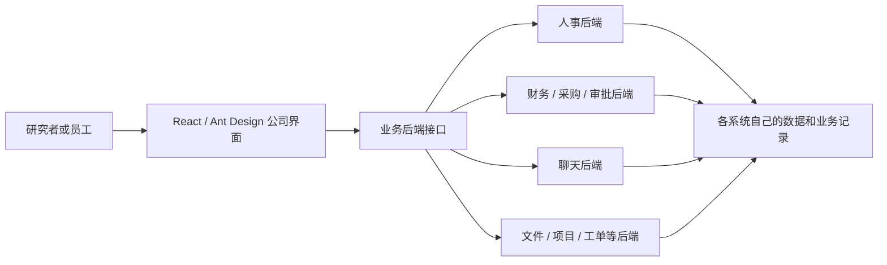
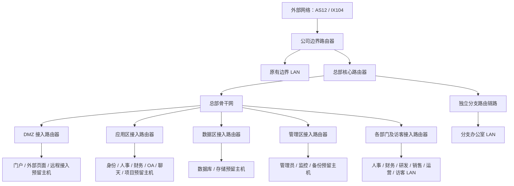

# 公司与组织仿真：业务系统选型与网络设计

调研日期：2026-11-16。

本次目标是仿真一家有部门、员工、总部和分支办公室的公司或组织。员工在真实业务后端中办公，研究者通过网页观察业务状态。本阶段只考虑人工操作。前端计划使用 React 与 Ant Design 重新制作，因此选型重点是后端业务、对外接口、实际采用情况和容器部署能力。

公司网络统一放在 H00 的 AS164 中，H98 只组合和部署系统。H98 已接入现有 CloudDriveService，其余候选逐项开发，不创建 E98，也不接入现有 Email、Bank、Payment。财务软件仍在调研范围内，因为公司的预算、报销、采购和记账是公司内部业务。

## 1. 结论与选择原则

可以使用开源软件搭建这样的公司。建议先考虑以下业务后端，再逐个部署验证：

| 业务 | 优先进入部署验证的候选 | 选择原因 |
| --- | --- | --- |
| 统一登录与身份 | Keycloak | 有标准登录协议、管理 API 和公开采用名单 |
| 人事、考勤、请假、工资计算 | Frappe HR；独立系统备选 OrangeHRM Starter | 前者有人事与财务协同及具体采用案例，后者可独立做人事管理 |
| 财务、采购、库存、销售订单 | ERPNext | 一套后端覆盖多项实际业务，有公开企业案例和统一 API |
| 日常审批 | ERPNext 工作流 | 可以先复用请假、报销和采购单据的审批，减少重复系统 |
| 工作聊天 | Mattermost Team Edition、Zulip | 都有自托管和 API；前者企业采用证据更突出，后者接口文档直接完整 |
| 文件共享 | 复用现有 CloudDriveService（Nextcloud） | 已有应用、数据库和对象存储的部署实现，直接接入 H98 |
| 日历、通讯录 | Nextcloud 对应应用 | 可沿用同一产品，但现有 CloudDriveService 不代表已经配置这些应用 |
| 项目与任务管理 | OpenProject | 有企业和公共组织采用证据，提供项目与任务 API |
| IT 报修、设备与资产 | GLPI | 真实使用案例具体，覆盖设备和服务请求 |
| 客服工单 | Zammad | 有实际客户案例，官方明确说明可通过 API 完成界面操作 |
| 代码托管与研发协作 | GitLab CE | 企业采用广，具有 Git、REST API、Webhook 等接口 |
| 经营分析 | Apache Superset；备选 Metabase 开源版 | 有实际采用证据，可查询和展示公司的业务数据 |

这是部署验证的优先名单，不是最终确定的全套组合。已有套件中的模块可以共用一个后端，不必为了“每种业务一个名字”重复部署多个功能相同的系统。

选择时按以下顺序考虑：

1. **后端确实在处理业务。** 要有员工、审批、单据、权限、历史记录等实际功能。
2. **有真实采用证据。** 优先具体客户案例、用户自己的技术文章和项目维护的采用名单，不用 GitHub 星数代替使用情况。
3. **我们能取得并部署需要的版本。** 区分开源版、商业版和云服务，尤其不能把商业版的案例当成开源版功能清单。
4. **接口足以支撑新前端。** 不只看“有 API”，还要看提交、审批、撤销、附件、分页、消息推送等操作是否开放。
5. **能在容器和仿真网络中独立运行。** 明确数据库、缓存、后台任务等依赖，不把它们误当成一个不需要维护的网页。

## 2. 真实采用情况：哪些已经查到证据

以下是本次查到的公开证据。案例可能反映历史部署；除来源明确说明外，不据此推断组织今天仍使用同一版本、全部门都使用，或使用的是免费版。

| 产品 | 公开组织或公司 | 证据性质与边界 |
| --- | --- | --- |
| ERPNext / Frappe HR | Zerodha | 官方具体案例列出 ERPNext、Frappe HR，以及采购、财务、人事、资产等模块；案例说明其用于内部运营，不应解读成证券交易平台本身运行在 ERPNext 上 |
| Odoo | Toyota Material Handling | 官方客户文章介绍库存和业务管理；对象是 Toyota 的相关业务实体，不是“整个丰田集团都用开源社区版” |
| Mattermost | 美国空军第 618 空中作战中心 | 官方合同完成公告，可证明实际组织采用，不能据此证明其采用 Team Edition |
| Nextcloud | Deutsche Telekom / T-Systems | 官方案例介绍 MagentaCLOUD 的迁移；这是大型服务部署证据，不能等同于德国电信所有员工的内部办公系统 |
| GitLab | Siemens | 官方案例介绍公司内部代码协作平台；不能直接推出案例里每个高级功能都属于 CE |
| OpenProject | Siemens、Audi、Deutsche Bahn 等 | 官方客户名单，属于产品采用证据；名单本身没有说明具体部门、规模或版本 |
| GLPI | Airbus、La Poste；法国 CNAF | 前两者在官方客户名单中；CNAF 还有具体设备管理和工单案例 |
| Keycloak | Accenture、CERN、HPE、Hitachi 等 | 项目仓库的社区调查公开引用名单，属于组织自报，并非逐家部署审计 |
| Zammad | Vossen、Schenker Technologies 等 | 官方提供具体客服案例，比仅展示客户图标更便于判断实际用途 |
| Apache Superset | Airbnb、Lyft、American Express 等 | Apache 项目维护的公开使用名单，不能推出各家的完整部署架构 |
| Metabase | Gojek | 官方具体案例介绍客服、开发排查和日常报表用途 |

证据来源：[Zerodha 案例](https://frappe.io/stories/Zerodha)、[Toyota Material Handling 案例](https://www.odoo.com/ro_RO/blog/customer-reviews-6/how-toyota-uses-odoo-after-just-6-months-of-integration-312)、[Mattermost 合同公告](https://mattermost.com/newsroom/press-releases/mattermost-completes-contract-with-u-s-air-force-618th-air-operations-center-to-deliver-real-time-mission-critical-communications/)、[德国电信迁移案例](https://nextcloud.com/blog/migration-deutsche-telekom-by-t-systems/)、[Siemens / GitLab 案例](https://about.gitlab.com/customers/siemens/)。

补充来源：[OpenProject 客户名单](https://www.openproject.org/customers/)、[GLPI 客户名单](https://www.glpi-project.org/fr/clients-2/)、[CNAF / GLPI 案例](https://www.glpi-project.org/en/cnaf-glpi-customer-story/)、[Keycloak 采用名单](https://github.com/keycloak/keycloak/blob/main/ADOPTERS.md)、[Zammad 客户案例](https://zammad.com/en/customers/)、[Superset 使用名单](https://superset.apache.org/inTheWild/)、[Gojek / Metabase 案例](https://www.metabase.com/case-studies/go-jek)。

OrangeHRM、Horilla、BookStack、EspoCRM 等仍然值得研究，但本次没有核实到同等明确、与计划使用的开源版本对应的知名企业案例，不把它们包装成已经确认的大企业标准系统。

## 3. 公司业务全景

公司类型不同，不会使用完全相同的软件。下面覆盖通用办公、经营、研发和 IT 运维，再列出按行业增加的业务。表中的“后续”都是调研候选，本次没有部署。

| 业务 | 员工实际会做的事情 | 开源候选或现有产品模块 | 建议阶段 |
| --- | --- | --- | --- |
| 账号、部门与角色 | 登录、加入部门、离职后停止访问 | 各系统原生账号；后续接入 Keycloak，需要目录服务时再考虑 FreeIPA / Samba AD | 后续统一 |
| 员工档案 | 入职、调岗、离职、维护主管关系 | Frappe HR / OrangeHRM Starter / Horilla | 第一批 |
| 招聘 | 发布职位、筛选简历、安排面试 | 上述人事软件的招聘模块 | 后续 |
| 考勤与休假 | 签到、申请请假、主管审批 | Frappe HR / OrangeHRM Starter / Horilla | 第一批 |
| 工资与绩效 | 计算工资、查看工资单、进行绩效评价 | Frappe HR；其他产品按版本核实 | 后续 |
| 财务与预算 | 记录费用、查看预算和经营报表 | ERPNext / Dolibarr；Odoo Community 待核实所需模块 | 人事之后 |
| 报销与出差 | 提交费用和附件、审批、记录报销结果 | Frappe HR + ERPNext / Dolibarr | 人事之后 |
| OA 审批 | 采购、出差、用章等申请逐级审批 | ERPNext 工作流；复杂门户备选 O2OA | 第一批 |
| 采购与供应商 | 询价、采购订单、收货、供应商账单 | ERPNext / Odoo Community / Dolibarr | 后续 |
| 客户与销售 | 登记客户、跟进商机、报价、销售订单 | ERPNext / EspoCRM / Odoo Community | 后续 |
| 合同与档案 | 保存合同、登记有效期、搜索原件 | ERPNext 的业务记录 + Nextcloud / Paperless-ngx | 后续 |
| 库存与物流记录 | 入库、出库、盘点、登记发货 | ERPNext / Odoo Community | 按公司类型 |
| 公司设备与资产 | 领电脑、退还设备、分配软件许可证 | GLPI / Snipe-IT / ERPNext 资产模块 | 后续 |
| 工作聊天 | 私聊、部门频道、项目讨论 | Mattermost Team Edition / Zulip | 第一批 |
| 通知与公告 | 发布制度、通知员工、查询公告 | OA、知识库或聊天系统 | 第一批 |
| 文件共享 | 上传、下载、共享和恢复文件版本 | 复用 CloudDriveService | 已接入部署配置 |
| 知识库 | 阅读制度、维护操作手册、搜索经验 | BookStack；也可先用已有项目 Wiki | 后续 |
| 日历与会议安排 | 邀请同事、查看会议时间 | Nextcloud Calendar / Contacts | 后续 |
| 音视频会议 | 进入会议室、语音视频、共享屏幕 | Jitsi Meet；也可研究 Nextcloud Talk | 后续 |
| 项目和任务 | 建项目、分配任务、记录进度和工时 | OpenProject / GitLab Issues | 第一批 |
| 客服 | 登记问题、分配客服、回复和关闭工单 | Zammad / GLPI | 后续 |
| 内部服务台 | 电脑报修、申请权限、提交行政请求 | GLPI / Zammad | 后续 |
| 软件研发 | 提交代码、合并评审、构建和发布 | GitLab CE；构建执行另配 Runner | 按公司类型 |
| 培训与考试 | 学习入职课程、答题、查看成绩 | Moodle LMS | 后续 |
| 数据分析 | 查询业务指标、查看部门和公司报表 | Apache Superset / Metabase 开源版 | 后续 |
| IT 运维 | 查看故障、服务指标、告警和日志 | Prometheus + Grafana 开源版；日志另选组件 | 后续 |
| 网站和内容发布 | 更新公司介绍、新闻和外部页面 | 可复用套件网站模块，或另选独立 CMS | 按需求专项调研 |
| 行业业务 | 生产工单、物料消耗、设备维护等 | 先研究 ERPNext / Odoo 的对应模块 | 确定行业后专项调研 |

表中的合同管理不等于已经具备电子签约；登记发货不等于接通真实快递网络；生成工资单也不等于已经把工资转入银行。这些边界应在每个系统开发时明确。

## 4. 候选后端逐项评估

### 4.1 统一身份：Keycloak

可以把它理解为公司的“统一登录中心”。员工使用自己的身份登录各个已接入的应用，系统管理员管理账号、分组和角色。它支持 OpenID Connect、OAuth 2.0、SAML，并提供用户和应用管理 API。官方也提供容器运行方式。[产品与协议说明](https://www.keycloak.org/)、[管理 API](https://www.keycloak.org/docs-api/latest/rest-api/index.html)、[容器部署](https://www.keycloak.org/server/containers)

对 Ant Design 前端的适配方向比较明确：新前端走登录流程取得用户身份，业务请求仍由各业务后端检查权限。Keycloak 不是员工档案系统，也不会自动让所有软件理解“这个人是 Alice 的主管”。

如果将来需要仿真工作站加入公司域、LDAP 或 Kerberos，再单独考虑 FreeIPA 或 Samba AD。Keycloak 可以连接已有目录，但本身不是 Active Directory 的完整替代。Samba 官方说明其可以提供 AD 域控制器以及 SMB 文件服务；这类需求与网页统一登录不同。[Samba 官方说明](https://www.samba.org/samba/what_is_samba.html)、[FreeIPA 接口说明](https://www.freeipa.org/page/API)

**初步判断：优先候选。** 是否先部署统一登录，可以在第一个业务系统接入时决定，不要求每个后续系统都依赖它才能单独运行。

### 4.2 人事：Frappe HR、OrangeHRM Starter、Horilla

**Frappe HR** 覆盖员工、招聘、请假、考勤、报销、绩效和工资计算。Zerodha 案例明确涉及其人事和工资用途，因此实际采用证据比本次找到的其他人事候选更充分。[功能介绍](https://frappe.io/hr)、[Zerodha 案例](https://frappe.io/stories/Zerodha)

它依赖 ERPNext，不适合描述成一个完全独立的人事后端；如果决定使用 ERPNext 财务，这个依赖反而可以减少员工、公司和费用信息的重复维护。其业务接口沿用 Frappe 的文档 API 和开放方法，审批等操作要调用业务逻辑。[依赖说明](https://docs.frappe.io/cloud/common-issues/required-app-not-found)、[API 文档](https://docs.frappe.io/framework/user/en/api/rest)

**OrangeHRM Starter** 是独立人事系统的候选。官方列出的开源版基础能力包括员工档案、员工自助、请假、工时、招聘和绩效。不能把 Advanced 的培训、复杂入职等功能直接算到 Starter 上，也不默认认为 Starter 提供完整工资核算。仓库包含 Dockerfile，部署和接口仍需围绕选定版本验证，不能套用旧 API 文档就承诺兼容。[Starter 功能](https://orangehrm.com/orangehrm-starter-open-source-software)、[版本比较](https://orangehrm.com/pricing)、[源码仓库](https://github.com/orangehrm/orangehrm)

**Horilla** 同样提供人事、考勤、休假、工资等模块，项目说明存在令牌 API 和 Docker 部署方案。功能上可作为独立系统备选，但本次未找到充分的知名企业采用证据，因此不按“功能列表很长”就将其排在人事首位。[官方仓库](https://github.com/horilla/horilla-hr)、[容器部署](https://github.com/horilla/horilla-hr/blob/2.0/docker/README.md)

**初步判断：套件路线先验证 Frappe HR，独立路线先比较 OrangeHRM Starter 的 API。**

### 4.3 财务、采购、库存和销售：ERPNext、Odoo、Dolibarr

**ERPNext** 是当前最值得先验证的公司业务后端。它已经实现财务、采购销售订单、库存、资产、生产和项目等模块，可以通过配置启用需要的部分。它是业务软件，不需要我们先写一个财务系统才能使用。[官方项目与功能](https://github.com/frappe/erpnext)、[财务说明](https://docs.frappe.io/erpnext/accounting-introduction)

它适合改 Ant Design 前端的主要原因是：业务数据有统一接口，也可以调用开放的服务器方法。需要保留后端的提交、审批和单据关联，不能把“新建采购订单”简化成随意写一条数据库记录。标准部署涉及应用、数据库、缓存、后台工作进程等，通常适合 Bundle；最终按实际容器组织确定。[API](https://docs.frappe.io/framework/user/en/api/rest)、[官方部署项目](https://github.com/frappe/frappe_docker)

**Odoo Community** 值得作为重点对照候选，它有真实企业采用证据和成熟的模块体系。Toyota Material Handling 的官方文章说明了实际库存和业务管理用途，但这是较早的产品案例，不能直接证明最新版社区版拥有文中全部能力。[官方社区版入口](https://www.odoo.com/page/community)、[Toyota Material Handling 案例](https://www.odoo.com/ro_RO/blog/customer-reviews-6/how-toyota-uses-odoo-after-just-6-months-of-integration-312)

Odoo 要单独核实所选 Community 版本的财务、审批、工资和接口。官方 API 文档同时讨论云服务套餐限制和不同版本的接口变化，不能把云套餐限制直接当成自托管 Community 的结论，也不能据此承诺所有开源模块都可无缝调用。本次尚未核实完整的社区版功能矩阵，因此保留为重点备选。[官方接口文档](https://www.odoo.com/documentation/19.0/developer/reference/external_api.html)

**Dolibarr** 可以作为较集中的中小企业业务候选，涵盖账单、采购销售、费用和会计，有官方 Docker 项目和 REST API。若只需要基本经营与记账，可与 ERPNext 做部署成本对比。[会计功能](https://www.dolibarr.org/presentation-double-entry-accounting.php)、[Docker 项目](https://github.com/Dolibarr/dolibarr-docker)、[REST API](https://wiki.dolibarr.org/index.php/Module_Web_Services_REST)

本阶段没有 Bank / Payment，因此财务操作做到单据、预算、应收应付和付款记录即可。网页中的“已支付”不会被宣称为外部银行已经完成转账。

**初步判断：ERPNext 优先；Odoo Community 做版本级对照；Dolibarr 保留为简化方案。**

### 4.4 OA 与审批：先用业务单据工作流，再考虑 O2OA

员工申请请假或采购，主管审批，金额较大时再交给财务或负责人，这类流程可以先使用 ERPNext 的工作流。它允许定义状态、角色和状态转换，业务单据仍由原后端保存。[工作流说明](https://docs.frappe.io/erpnext/workflows)

**O2OA** 的定位更偏向办公门户、表单和流程搭建平台。它有服务器包、容器部署和接口，但要准备业务表单与流程。既然我们计划重做前端，不能把“有一个门户编辑器”当作主要优势。V10 社区版还有限定使用 H2 数据库的版本边界。[官方项目](https://github.com/o2oa/o2oa)、[下载与社区版限制](https://www.o2oa.net/download.html)

**初步判断：先验证 ERPNext 已有业务审批。** 只有发现缺少具体 OA 场景时，再选择独立 OA。流程引擎本身不等于一套开箱即用的办公系统。

### 4.5 工作聊天：Mattermost Team Edition 与 Zulip

**Mattermost** 有实际大型组织采用证据，也有 REST API、消息事件接口和官方容器。用 Ant Design 制作频道列表、私聊、历史消息和附件页面在接口层面可行；新消息需要接入事件机制，不能只写一个发送消息的 HTTP 表单。[API 文档](https://docs.mattermost.com/api)、[官方镜像](https://docs.mattermost.com/developers/contribute/more-info/containers)

需要选定 **Team Edition**，区分商业 Enterprise / Entry 的功能。当前官方将 Team Edition 定位于少于 250 个激活用户、无需单点登录的小团队场景。因此不能一边选择免费版，一边默认承诺具备企业单点登录和全部审计能力。[版本说明](https://docs.mattermost.com/product-overview/editions-and-offerings)、[许可说明](https://docs.mattermost.com/product-overview/faq-license)

**Zulip** 的特点是频道内还可以按话题组织讨论。其 REST API 支撑客户端操作，官方提供自托管和容器方式，适合自制前端。每个员工可以使用自己的身份调用。[API 文档](https://zulip.com/api/rest)、[自托管说明](https://docs.zulip.com/self-hosting/)

**初步判断：重视企业采用与常见聊天形态时先比较 Mattermost；重视开源接口和后续员工规模时同时验证 Zulip。** 选择前应实际测试登录、收发、历史、附件和实时通知五条链路。

### 4.6 文件、通讯录和日历：复用 CloudDriveService

Nextcloud 可以承担公司文件柜、团队共享目录、通讯录和日历。德国电信的案例证明它不只是个人网盘项目，但具体办公功能仍由所装应用决定。

仓库中的 [CloudDriveService](../services/CloudDriveService/README.md) 已经使用 Nextcloud，因此不另做一个 Nextcloud Service 或 Bundle。它支持应用、PostgreSQL、对象存储三个逻辑角色，既可以放在一个节点，也可以分别绑定。本次在 H98 中选择分开放置，让应用区到数据区产生实际网络通信。日历和通讯录应用的启用不在本次配置中，后续单独验证。

它提供文件 WebDAV、共享 OCS API 等；日历使用 CalDAV。Ant Design 可以重做文件和日历页面，但协议适配不能只按普通 JSON 表格处理。[客户端接口目录](https://docs.nextcloud.com/server/latest/developer_manual/client_apis/index.html)、[日历说明](https://docs.nextcloud.com/server/stable/admin_manual/groupware/calendar.html)、[容器项目](https://github.com/nextcloud/docker)

若要多人编辑 Word / Excel 类文件，需要另配 ONLYOFFICE Docs 等编辑服务。它提供真实协同编辑能力，但编辑器不能仅靠 Ant Design 控件替代；更合理的是统一外围界面并保留编辑组件。社区版并发能力、品牌和嵌入条件应按具体版本核实。[ONLYOFFICE 官方仓库](https://github.com/ONLYOFFICE/DocumentServer)

**初步判断：文件共享直接复用 CloudDriveService；日历、通讯录和协同编辑按需增加。**

### 4.7 项目管理：OpenProject

OpenProject 对应公司里的项目、任务、负责人、截止时间和工时记录，适合“经理分配工作，员工更新进度”的仿真。官方客户名单包括 Siemens、Audi、Deutsche Bahn 等，另有公共组织的具体项目管理案例。[客户名单](https://www.openproject.org/customers/)、[公共组织案例](https://www.openproject.org/blog/public-sector-project-management-case-studies/)

它提供 API v3 和容器部署，但官方明确说明并非所有资源和动作都已通过 API 开放。因此基础任务页面适合优先验证，不承诺完整复制原管理站点；甘特图、复杂计划等页面也需要额外前端工作。[API 边界](https://www.openproject.org/docs/api/)、[Docker 部署](https://www.openproject.org/docs/installation-and-operations/installation/docker/)

**初步判断：优先候选。** 如果公司暂时只需要简单研发任务，也可以先使用 GitLab Issues，避免重复。

### 4.8 IT 报修与资产：GLPI；资产专用备选 Snipe-IT

GLPI 可同时维护设备、设备所属员工、软件信息以及报修工单。一个具体场景是“员工领电脑 → 使用中报修 → IT 人员处理 → 离职归还”。这会产生真实业务记录，也能与仿真网络设备关联。

它既有公开企业名单，也有 CNAF 等组织的具体使用案例。官方提供 Docker 项目和 API；新版高层 API 与旧接口覆盖范围并不完全相同，部署时应固定版本。[官方容器](https://github.com/glpi-project/docker-images)、[API 说明](https://help.glpi-project.org/documentation/modules/configuration/general/api/restful-api-v2)

如果只想做设备领用归还而不需要综合服务台，可以考虑 Snipe-IT，其官方项目明确提供 JSON REST API、资产管理和目录集成能力。本次未核实到与 GLPI 同等具体的知名组织使用证据，暂作功能备选。[官方项目](https://github.com/grokability/snipe-it)

**初步判断：GLPI 优先。** IT 资产在系统里的记录，不会自动发现或控制仿真容器；这部分关联需要之后开发。

### 4.9 客服工单：Zammad

Zammad 适合客户咨询和内部服务请求，能记录提出问题的人、处理人、回复以及工单状态。官方有 Vossen、Schenker Technologies 等案例；官方 API 文档明确说明可以通过接口完成 UI 中的操作。[客户案例](https://zammad.com/en/customers/)、[API 说明](https://docs.zammad.org/en/latest/api/intro.html)

它有 Docker Compose 部署方案，包含后台服务及相关依赖，适合按实际结构封装为 Bundle。即使暂时不接邮箱，也可以先验证网页/API 创建、回复和关闭工单。[部署说明](https://docs.zammad.org/en/latest/install/docker-compose.html)

**初步判断：客服业务优先候选；若 GLPI 已满足内部报修，先不重复部署另一套内部服务台。**

### 4.10 客户和销售：ERPNext CRM；独立备选 EspoCRM

销售员工需要维护客户、联系人、跟进记录和商机。如果已选择 ERPNext，可先检查其已有模块，避免客户和销售订单分散。

独立候选 EspoCRM 的前端本来就通过 REST API 连接后端，官方说明 UI 操作可以用 API 完成，因此适合新前端接入。其独立部署也有 Docker 方案；高级自动化、报表或扩展不能默认都属于开源核心。本次没有核实到足够明确的知名公司开源版部署案例。[API 说明](https://docs.espocrm.com/development/api/)、[容器安装入口](https://docs.espocrm.com/administration/installation-by-script/)、[官方项目](https://github.com/espocrm/espocrm)

**初步判断：先复用 ERPNext；需要独立销售系统时再验证 EspoCRM。**

### 4.11 知识库与文件归档：BookStack、Paperless-ngx

BookStack 适合员工手册、操作规范和知识文章，提供页面组织、权限及 API。其接口在实例内有文档，适合先实现查阅、搜索和编辑文章。项目仓库已说明主维护位置迁到 Codeberg，后续应以当前发布源为准。本次没有核实到知名企业的具体部署案例。[项目入口](https://github.com/BookStackApp/BookStack)、[API 路由源码](https://github.com/BookStackApp/BookStack/blob/development/routes/api.php)

Paperless-ngx 更偏向合同、扫描文件和票据的识别、分类与归档，提供 REST API。它可以补充文件柜，但不是合同谈判、用章审批和电子签约的完整替代；也不把社区热度等同于大公司部署证据。[官方项目](https://github.com/paperless-ngx/paperless-ngx)、[接口文档源码](https://github.com/paperless-ngx/paperless-ngx/blob/main/docs/api.md)

**初步判断：两者作为后续候选；先用 Nextcloud 和项目 Wiki 也可以开始办公仿真。**

### 4.12 研发：GitLab CE

GitLab 可以支撑仓库、分支、代码评审、问题跟踪和构建流程。Siemens 案例使它很符合“真实组织正在采用的业务后端”这一方向。[Siemens 案例](https://about.gitlab.com/customers/siemens/)

代码内容仍通过 Git 协议交互，项目、问题和合并请求可走 REST API。Ant Design 可以先做日常协作页面，不必一次重写完整代码浏览器和构建控制台。选择 CE / Free 对应能力；商业版安全和治理功能不能直接加入清单。[REST API](https://docs.gitlab.com/api/rest/)

官方 Docker 镜像可以把所需服务放在一个容器中，因此不能只凭“GitLab 很大”就决定用 Bundle；是否使用原生 Service，还是另加 Runner 等容器后用 Bundle，要看部署方案。[官方 Docker 组织方式](https://docs.gitlab.com/install/docker/)

**初步判断：如果仿真科技或软件公司，优先级很高；一般行政组织可后置。**

### 4.13 经营分析：Apache Superset、Metabase

Superset 用于查询、图表和看板，其项目维护的公开名单包含 Airbnb、Lyft 等。提供 OpenAPI 描述的 REST API，适合将后端查询结果展示在自制前端里。[采用名单](https://superset.apache.org/inTheWild/)、[API 文档](https://superset.apache.org/developer-docs/6.1.0/api/)

Metabase 可以作为另一种分析后端，Gojek 有具体公开案例，也有容器和 API 文档入口。应选择开源版并核实自制前端需要的接口；不能把收费嵌入、单点登录或权限功能自动算入开源方案。[Gojek 案例](https://www.metabase.com/case-studies/go-jek)、[Docker 部署](https://www.metabase.com/docs/latest/installation-and-operation/running-metabase-on-docker)、[API 入口](https://www.metabase.com/docs/latest/api)

**初步判断：后续优先比较 Superset 和 Metabase。** 分析层主要读取业务数据，不能替代员工在原系统里提交审批、采购或报销。

### 4.14 培训、日历和音视频会议

培训可选择 **Moodle LMS**，用于课程、作业和考试，有对外 Web Service。要区分开源 LMS 与 Moodle Workplace，后者官方明确说明并非开源产品。本次不以 Workplace 的商业企业案例证明开源 LMS 有全部企业培训功能。[外部接口](https://moodledev.io/docs/5.1/apis/subsystems/external)、[版本区别](https://support.moodle.com/support/solutions/articles/80001074804-difference-between-moodle-workplace-and-moodle-lms)

日历、通讯录先复用 Nextcloud。视频会议可研究 **Jitsi Meet**，官方支持自托管、Docker 和网页集成。但其接口更多围绕会议客户端和控制，不等同于普通表单 API；实际语音视频还涉及媒体流和浏览器环境。[官方说明](https://jitsi.github.io/handbook/)、[容器部署](https://jitsi.github.io/handbook/docs/devops-guide/devops-guide-docker/)

**初步判断：后置。** 文字沟通和会议安排已经可以先形成组织协作，实际音视频链路需要单独验证。

### 4.15 IT 运维与基础设施

Prometheus 可收集和查询服务指标，Grafana 开源版用于看板。它们可以为 IT 部门提供真实的服务故障与恢复信息；采集数据仍需部署相应 exporter 或接入应用指标，不能凭空得到所有业务状态。[Prometheus 安装](https://prometheus.io/docs/prometheus/latest/installation/)、[查询 API](https://prometheus.io/docs/prometheus/latest/querying/api/)、[Grafana 接口说明](https://grafana.com/docs/grafana/latest/developers/http_api/)

DNS 继续使用 SeedEmu 原生服务。远程接入、内部目录、备份和日志集中管理需要根据后续实验目标分别选型，本次只预留主机和网络，不把名为 `vpn`、`backup` 或 `monitoring` 的主机说成已安装对应服务。

## 5. 用 Ant Design 重做前端，具体复用哪些东西

目标是保留真实后端的用户、权限、业务规则、数据库和历史记录，替换员工看到的页面。员工通过新前端操作原业务后端，业务记录继续由原系统维护。

图里的“业务后端接口”表示各系统的接口集合，不要求新增一个通用代理服务器，也不要求所有产品共享数据库。新前端可以做统一导航，同时让每个系统保有独立业务。

| 前端需要的能力 | 后端必须实际提供的能力 |
| --- | --- |
| 员工登录 | 用户身份、会话或令牌、权限检查 |
| 列表和详情 | 查询、搜索、过滤、分页 |
| 提交申请 | 字段校验、业务单据创建、附件关联 |
| 审批或撤销 | 合法的状态转换、操作者权限、历史记录 |
| 实时聊天 | 消息收发、历史查询、事件订阅、断线重连 |
| 文件和日历 | 文件上传下载、共享权限、WebDAV / CalDAV 等协议 |
| 多系统联动 | 明确的账号映射、业务结果通知和重复请求处理 |

因此，“API 适合度”要按具体操作评价。CRUD 接口足够展示员工列表，但不一定足够运行一次完整报销审批。遇到缺失业务接口，可以在原后端增加小型扩展；不要把原来后端的规则搬到 React 中重新实现。

编辑文档、代码差异和音视频会议等复杂功能，可以保留专用组件或暂时保留原页面入口。Ant Design 能统一外围操作界面，但不会自动提供一个新的 Word 编辑器或视频会议引擎。

## 6. H98 的公司网络

入口为 `examples/H98_virtual_company/virtual_company.py`，提供简洁的 `build_emulator()`，返回尚未 render 的原生 Emulator。

H00 负责在 **AS164** 中创建总部和分支结构。H98 导入 H00 的网络后，只安装系统、设置绑定和注册系统域名，不再创建路由器或 LAN。AS164 没有被 H99 的业务系统使用；E99 仍使用原有 AS171。本次修改 H00，未修改 seed-emulator。

| 网络 | 地址 | 当前主机用途 |
| --- | --- | --- |
| 原有边界 LAN | `10.164.0.0/24` | 保留 H00 的两个主机 |
| 总部骨干 | `10.164.1.0/24` | 核心与接入路由器互联 |
| 边界与核心链路 | `10.164.2.0/30` | 边界 `.1`、核心 `.2` |
| 核心与分支链路 | `10.164.3.0/30` | 核心 `.1`、分支 `.2` |
| DMZ | `10.164.10.0/24` | portal、website、vpn |
| 业务应用区 | `10.164.20.0/24` | identity、hr、finance、oa、chat、projects、cloud |
| 数据区 | `10.164.30.0/24` | database1、database2、storage |
| 管理区 | `10.164.40.0/24` | admin、monitoring、backup |
| 人事部门 | `10.164.50.0/24` | hr1–hr3 |
| 财务部门 | `10.164.60.0/24` | finance1–finance3 |
| 研发部门 | `10.164.70.0/24` | engineer1–engineer4 |
| 销售部门 | `10.164.80.0/24` | sales1–sales3 |
| 运营部门 | `10.164.90.0/24` | operations1–operations3 |
| 访客 | `10.164.100.0/24` | guest1–guest2 |
| 分支办公室 | `10.164.110.0/24` | branch1–branch3 |

业务和办公 LAN 的网关为 `.254`，主机按代码中的顺序从 `.10` 分配。默认配置下，公司 AS 内共有 39 台主机和 13 台路由器，其中 37 台主机与 12 台路由器是本次新增。每个原生节点对应一个容器。

保留 H00 外部网络后，本次在当前编译器下生成的完整 Compose 配置有 116 个服务条目、44 个网络条目。这里包含周围网络、DNS 和 Internet Map，并不是已经部署了 116 个公司业务。

H98 通过 H00 的 DNS 接口注册 `cloud.company.com`，指向 `10.164.20.16`。部门工作站目前只分配 IP，后续业务按需注册域名。所有主机使用 `10.150.0.54` 递归解析，DNSSEC 关闭；`company.com` 由现有托管 nameserver 承载。

当前 LAN 之间通过路由通信，没有防火墙访问控制、VLAN 标签、VPN 隧道或分支链路延迟。DMZ、数据区和访客区目前表示拓扑用途，不表示已经实施安全隔离。后续确定业务通信关系后，再增加明确的访问策略。

当前复用原生 CloudDriveService：应用绑定到应用区的 `cloud`，PostgreSQL 绑定到数据区的 `database1`，对象存储绑定到数据区的 `storage`。其他应用主机仍是预留角色。后续原生 Service 绑定到相应主机，Bundle 则按实际容器组织连接渲染后的应用、数据等 LAN。不会为了一个后端包含多个逻辑模块，就机械拆成多个 Bundle。

## 7. 建议逐个开发的顺序

1. **先复用网盘。** H98 已加入 CloudDriveService 的部署配置，先验证跨 LAN 访问、文件上传下载和共享，不重复开发已有系统。
2. **第一项新开发：ERPNext + Frappe HR 的人事与请假审批。** 先完成员工、部门、主管、请假申请、审批与历史记录。Frappe HR 依赖 ERPNext，可以作为同一套部署逐步启用功能。这样能先建立真正的组织关系和日常业务。
3. **第二项新开发：工作聊天。** 优先验证 Mattermost Team Edition，Zulip 作为对照。先实现私聊、部门频道、历史消息、附件与实时更新，让员工能够围绕申请和工作进行沟通。
4. **第三项新开发：OpenProject。** 增加项目、任务、负责人和进度。它能让公司有具体工作内容，而不只是通信和审批。
5. **沿用 ERPNext 开启报销与采购。** 复用员工和组织数据，增加金额、附件、预算和采购单据。只做内部业务记录，不接 Bank / Payment。
6. **再加入 GLPI 和统一登录。** GLPI 增加领用设备、报修和处理流程；Keycloak 在多个系统各自能正常运行后接入，逐项核实所选开源版本支持的登录方式。Keycloak 不作为前几项开发的前置条件。
7. **最后按公司类型补充。** 软件公司加入 GitLab；销售型公司加入客户和订单；制造公司再研究生产与库存；分析、培训、音视频会议后置。

每个后端先确认登录、创建业务、状态变化和查询结果，再做对应 Ant Design 页面。先制作员工常用的少量页面，原管理界面可以继续用于配置和对照，不要求一次重写整套管理网站。

统一身份和跨系统连接可以随需求逐步加入，不提前创建一个承担所有业务的中央服务。员工有独立稳定的人员 ID，各系统账号保留自己的 ID；同名员工不应被当成同一人。

## 8. 本次交付和验证范围

- 将公司网络放入 H00 的 AS164，H98 仅部署应用，Internet Map 默认开启。
- 复用 CloudDriveService，分开部署应用、数据库和对象存储，注册网盘域名并映射网页端口。
- 生成网络的 Docker 编译产物，并通过 `docker compose config --quiet` 校验。
- 完成官方资料和 API 文档调研，未开发新的业务后端或 Ant Design 前端，也未构建、启动业务容器。
- 本次没有创建 E98，没有接入 Email、Bank、Payment，没有修改现有业务系统。

完整网络的启动方法见 [H98 README](../examples/H98_virtual_company/README.md)。业务系统的版本、镜像、接口覆盖和资源使用，在选定每一项后再做部署验证。
