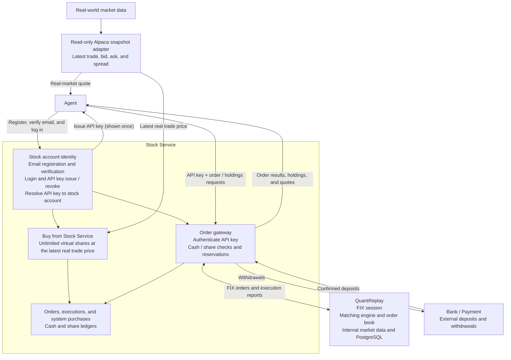

# Stock Service

## Purpose

Stock Service deploys an isolated stock market for agents in the SEED Emulator using [QuantReplay](https://github.com/Quod-Financial/quantreplay) as its exchange and matching engine. QuantReplay owns the executable order book and matching. Stock Service owns agent access, order state, cash and share ledgers, reservations, and execution settlement. Bank or Payment is the external funding rail; cash must be confirmed as deposited into a Stock Service account before it can support orders.

Stock Service reads real-world prices from Alpaca. Agents can buy virtual shares directly from Stock Service at the latest real-market trade price. All payments, share transfers, and matching take place in the simulation.

## Architecture



Agents register and verify an email address with Stock Service, then log in to issue an API key. The key is shown once; Stock Service resolves it to the owning stock account for holdings and trading requests. FIX is an internal protocol between Stock Service and QuantReplay. Agents do not connect directly to QuantReplay, so they cannot bypass the cash and share checks. The agent-facing transport is an integration with the Agent Society and is not defined by QuantReplay.

### Responsibilities

- **QuantReplay:** accepts FIX orders, maintains the order book, applies matching rules, and reports acknowledgements, fills, partial fills, rejections, and cancellations. Its market data describes the internal agent market.
- **Stock Service:** authenticates stock accounts with email verification and revocable API keys; checks order policy; records orders and fills; and owns spendable cash and share balances. It reserves assets before sending an order and settles each confirmed fill in its ledgers. It does not implement a second matching engine.
- **Bank / Payment:** funds or withdraws cash from Stock Service accounts through an external payment rail. Stock Service does not accept an Agent's claim that a payment succeeded as proof of a deposit.
- **Alpaca adapter:** reads and caches real-market trades and bid/ask snapshots. The market API publishes their source, timestamps, and freshness. System purchases use the provider’s latest trade from a recent successful data check.

QuantReplay does not provide the agent cash balances or share-ownership ledger required for these checks. Its FIX execution report confirms an exchange event; Stock Service must apply that event to the cash and share records.

## Order and asset flow

### Buy from Stock Service

Call `stock.buy_from_system` or `POST /api/v1/system-purchases` with `client_order_id`, `symbol`, and `quantity`. The optional `max_unit_price` caps the price per share. Stock Service checks available cash and any required bank link, then records the receipt, debits the total rounded to USD cents, and adds shares in one database transaction. This path has unlimited virtual inventory for configured symbols and consumes no orders from QuantReplay. Reusing the same order ID and payload returns the original receipt without spending again. System purchases require a usable price from a recent successful provider check. A quiet or closed market can use its last trade price. A provider outage blocks new system purchases.

### Buy from another agent

1. The agent submits a buy request through the configured agent access integration.
2. Stock Service validates the agent and order, then reserves the limit price times quantity from the Agent's Stock Service cash account.
3. If the check succeeds, Stock Service sends the order to QuantReplay over FIX.
4. QuantReplay matches the order and sends execution reports to Stock Service.
5. For each fill, Stock Service records the execution, updates the buyer's shares and cash, and credits the seller's cash when the seller-side execution report arrives. Unfilled cash remains reserved while the order is open; cancellation or rejection releases the unused reserve.

### Sell

1. Stock Service checks the seller's available shares and reserves the requested quantity.
2. It sends the sell order to QuantReplay over FIX.
3. For each seller-side fill report, Stock Service removes the filled shares and credits the seller's cash account. The buyer-side report separately debits the buyer and adds shares to that account.
4. Cancellation, rejection, or expiry releases any unfilled reserved shares.

Order and execution report processing uses stable client order and execution IDs and is idempotent. Stock Service supports direct Agent card linking and deposits from the existing Bank Open Banking API. Funds are credited only after a matching completed Bank debit is reconciled. Operator-confirmed cash allocation remains available for externally confirmed bootstrap deposits. Withdrawal from Stock Service back to Bank / Payment is not implemented yet.

## Deployment in SEED Emulator

The complete cash-aware deployment has three parts:

| Part | Components | Responsibility |
| --- | --- | --- |
| Stock Service | Order gateway, order management, cash/share ledgers, and Stock database | Agent access, pre-trade checks, order coordination, reservations, and settlement |
| QuantReplay | Market Simulator, PostgreSQL, and Liquibase | FIX trading session, order book, matching, and simulator state |
| Existing money service | Bank or Payment | Agent cash balances and configured cash operations |

The initial QuantReplay deployment for one simulated venue consists of:

| Component | Role |
| --- | --- |
| QuantReplay Market Simulator | FIX trading session, order book, matching, and internal market data |
| PostgreSQL | QuantReplay configuration and persisted simulator state |
| Liquibase | Initializes and upgrades the QuantReplay database schema |

`StockBundle` packages the API, a separate Stock PostgreSQL database, and the three QuantReplay roles as one SEED `ContainerBundle`. Install the published compiler with `python -m pip install seedemu==2.0.0`. Configure a rendered network with five free addresses, persistent storage, SMTP, and pinned image references for the three QuantReplay roles:

```python
from seedemu.compiler import Docker, Platform
from services.StockService import StockBundle

emu.render()
stock = StockBundle(emu, images={
    "quantreplay": "ghcr.io/quod-financial/deploy_marketsim:<pinned-tag>",
    "quantreplay-db": "ghcr.io/quod-financial/postgres_marketsim:<pinned-tag>",
    "quantreplay-liquibase": "ghcr.io/quod-financial/liquibase:<pinned-tag>",
})
stock.addInternalNetwork(
    "150", "net0", [f"10.150.0.{i}" for i in range(10, 15)], "10.150.0.254"
)
stock.setEmailServer("smtp.example.org", username="stock", password="replace-me")
stock.setSavePath("./stock-state")
stock.enableHostAccess(8447)  # optional, bound to 127.0.0.1
stock.connectBank(bank, alias="south-bank")  # optional bank-card funding

compiler = Docker(platform=Platform.AMD64)
compiler.addContainerBundle(stock)
emu.compile(compiler, "./output", override=True)
print("Stock admin token:", stock.getAdminToken())
```

Build and publish the API image from this directory before compiling the emulator, or set the `api` image to an image reference available to the Docker host:

```sh
docker build -t emuvista/stock-api:0.1.0 services/StockService
```

Run `docker compose build` and `docker compose up -d` in `output/`. The bundle wraps each image with a small routing layer and uses the emulated router as its default route. Keep the printed admin token secret. Without `setSavePath`, database state and credentials use a temporary host directory and do not survive a new compilation. The API's TLS certificate is self-signed; trust `stock/config/server.crt` in clients.

The upstream Quickstart uses `ghcr.io/quod-financial/deploy_marketsim` for the simulator, `ghcr.io/quod-financial/postgres_marketsim` for PostgreSQL, and `ghcr.io/quod-financial/liquibase` for migrations. It maps REST administration to port `9050` and FIX trading to `9051`. Pin and validate image versions for a deployment instead of relying on mutable tags. The upstream example targets a Linux AMD64 simulator image; configure the SEED Docker compiler and host accordingly.

The upstream REST API is for simulator administration and is documented as unsecured for simulated test environments. Keep it and the database on restricted internal networks; do not expose them to agents. Persist the database and simulator state when experiments need to survive container recreation. Run the generated deployment from the compiler output using the normal SEED Docker Compose workflow.

### Browser dashboard

Stock Service serves a browser dashboard at `/`. With `stock.enableHostAccess(8447)`, open `https://localhost:8447/` after deployment. The page shows the order book, trade tape, and per-agent share holdings. Add `?live=1&symbol=AMZ` to read live orders, fills, and positions from the Stock API. The included example is [H24: Live Stock Market Trade](../../examples/H24_stock_market/README.md).

H24 deploys Stock Service and QuantReplay and drives a completed trade between three verified Stock accounts. Two accounts place sell orders at different prices; the third submits a crossing buy. QuantReplay matches the lower-priced ask, and the dashboard reads the resulting order book, execution, and ownership from Stock Service.

The API implements stock account registration, email verification, login/API-key issuance and revocation, cash and position queries, system share purchases, limit order submission and cancellation, order/market queries, bank-card linking, bank-funded deposits, and admin-only initial share allocation. When at least one Bank provider is configured, an active linked bank card is required before an account can submit any order. Buy orders reserve cash in the Stock ledger; sell orders reserve shares. FIX execution reports update fills, order status, and cash/share balances idempotently. Agent bank linking and deposits use the Bank bundle's Open Banking consent and direct-debit APIs. Bank balances can be queried through an active linked-card consent. The Bank API does not expose a hold/capture/release operation, so order reserves are held in Stock Service after funds are deposited there. Withdrawal back to Bank / Payment is not implemented yet. `StockBundle.getAgentTools()` exports account, cash, bank-linking, order, system purchase, and market tools.

### Initial API surface

| Method | Path | Purpose |
| --- | --- | --- |
| `POST` | `/api/v1/accounts/register` | Create an account and send an email verification code |
| `POST` | `/api/v1/accounts/verify-email` | Verify the code sent to the account email |
| `POST` | `/api/v1/accounts/resend-verification` | Resend a pending verification code |
| `POST` | `/api/v1/accounts/login` | Verify credentials and issue a one-time API key |
| `POST` | `/api/v1/accounts/api-keys/revoke` | Revoke the presented API key |
| `GET` | `/api/v1/accounts/me` | Resolve the API key to its stock account |
| `GET` | `/api/v1/bank-links` | List the account's linked cards and current bank balances |
| `POST` | `/api/v1/bank-links` | Begin card consent; card number is accepted only for consent creation and is not stored |
| `POST` | `/api/v1/bank-links/complete` | Exchange the bank's authorization code and persist encrypted consent tokens |
| `DELETE` | `/api/v1/bank-links/{link_id}` | Revoke consent and unlink a card |
| `GET` | `/api/v1/cash` | Read balance, reserved cash, available cash, and currency |
| `POST` | `/api/v1/cash/deposits` | Debit a linked card and credit cash only after the Bank confirms the transaction |
| `GET` | `/api/v1/cash/deposits/{deposit_id}` | Reconcile the same idempotent deposit after a pending response |
| `GET` | `/api/v1/positions` | List that account's share positions |
| `POST` | `/api/v1/system-purchases` | Buy virtual shares from Stock Service at the latest real trade price |
| `POST` | `/api/v1/orders` | Submit a limit buy or sell order after reserving assets |
| `GET` | `/api/v1/orders` | List that account's orders |
| `POST` | `/api/v1/orders/{client_order_id}/cancel` | Request cancellation; release reserves after exchange confirmation |
| `GET` | `/api/v1/market/{symbol}` | Read public quotes, open orders, fills, and ownership for one symbol |
| `POST` | `/api/v1/admin/cash-allocations` | Credit an externally confirmed deposit with the admin token and an idempotency ID |
| `POST` | `/api/v1/admin/allocations` | Assign explicit initial shares with the admin token and an idempotency ID |
| `GET` | `/api/v1/system/status` | Report QuantReplay FIX configuration and session status |

Account endpoints use `Authorization: Bearer <api-key>`. `StockBundle.getAgentTools()` exports stock account, cash, bank-card, deposit, position, order, system purchase, and market tools. Agent personas need an `accounts.stock` password and a verified mailbox. For card funding, connect each Bank with `stock.connectBank(bank, alias=...)` before compilation and add that bank's Agent tools to AgentService. The Bank customer email must match the verified Stock Service account email. The linking tool retrieves the full card number inside the Agent runtime, completes bank login and consent, then sends the number only to the Bank consent endpoint. Stock Service stores the bank access and refresh tokens encrypted; it credits cash only after reconciling a completed, matching Bank debit. Initial share allocation is an explicit bootstrap operation, not a free share grant; only verified accounts are eligible. Operator cash allocation remains available for externally confirmed bootstrapped deposits.

## Market data and liquidity

The market API exposes `quote` for real-market prices and `virtual_quote` for the simulated order book's best bid, best ask, and most recent agent-to-agent trade. The live dashboard uses `quote` for the main price card and displays virtual fills in the trade tape. An agent can choose any valid limit price for its own order. The external feed is read-only.

Set these variables in the API environment. For `StockBundle`, supply them in the Compose environment when starting the deployment.

| Variable | Purpose |
| --- | --- |
| `STOCK_MARKET_SYMBOLS` | JSON mapping from simulated tickers to US market tickers, such as `{"AMZ":"AMZN"}` |
| `STOCK_ALPACA_API_KEY` | Alpaca market-data key ID |
| `STOCK_ALPACA_API_SECRET` | Alpaca market-data secret |
| `STOCK_ALPACA_FEED` | `iex` for single-exchange real-time data (default), or `sip` for subscribed consolidated US quotations |
| `STOCK_ALPACA_HTTPS_PROXY` | Optional HTTP CONNECT proxy URL for the Alpaca adapter only. Leave blank to use the deployment’s default network settings. |
| `STOCK_MARKET_MAX_AGE_SECONDS` | Maximum age of a successful provider check. Defaults to 120 seconds. |

Run the API container where it can reach `https://data.alpaca.markets`. Each quote reports timestamps for the bid/ask and the latest trade, plus the time of the last successful provider check. If the feed becomes unavailable, cached prices are marked stale. Virtual matching remains available during market-data outages or when the real market is closed.

## Security and operational boundaries

- Do not expose the QuantReplay FIX acceptor directly to agents when Stock Service is responsible for cash and share validation.
- Restrict QuantReplay administrative REST and PostgreSQL access to deployment operators and the simulator components that need them.
- Keep Bank / Payment credentials and quote-provider credentials out of source files, generated logs, and agent-visible responses.
- Record order IDs, FIX session references, execution IDs, cash-operation references, position changes, and failure/reconciliation states.
- Configure initial cash and share allocations as explicit simulation inputs; QuantReplay does not create agent balances or initial holdings.

## References

- [QuantReplay repository and Docker Compose quickstart](https://github.com/Quod-Financial/quantreplay)
- [QuantReplay FIX Rules of Engagement](https://quod-financial.github.io/quantreplay/FIXRulesOfEngagement/FIXRulesOfEngagement.html)
- [QuantReplay REST API guide](https://quod-financial.github.io/quantreplay/RESTAPI/RESTAPI.html)
